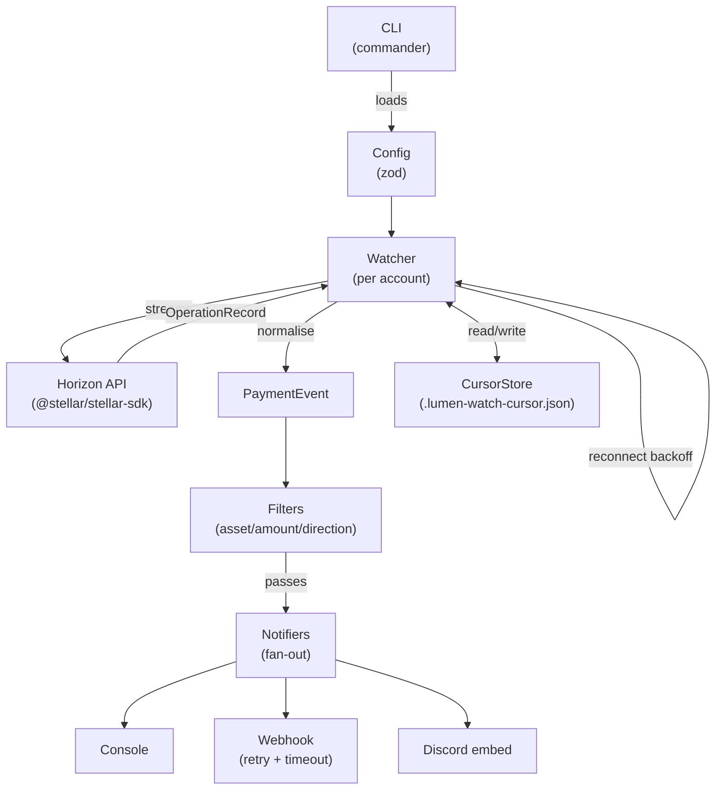

# lumen-watch

> Real-time Stellar account watcher — stream payment alerts to your console, webhook, or Discord.

[](https://github.com/yourusername/lumen-watch/actions/workflows/ci.yml)
[](https://www.npmjs.com/package/lumen-watch)
[](./LICENSE)
[](https://nodejs.org)

**lumen-watch** connects to the Stellar Horizon API, streams payment operations for one or more accounts, filters them by asset or amount, and fans the results out to pluggable notifiers. It handles reconnects automatically and resumes from the last seen cursor so no payment is ever missed.

---

## Table of Contents

- [What it is](#what-it-is)
- [Install](#install)
- [Quickstart](#quickstart)
- [CLI reference](#cli-reference)
- [Config reference](#config-reference)
- [Notifiers](#notifiers)
- [Architecture](#architecture)
- [Library API](#library-api)
- [Contributing](#contributing)
- [Roadmap](#roadmap)
- [Stellar Wave](#stellar-wave)
- [License](#license)

---

## What it is

lumen-watch is a **read-only** tool. It never handles private keys or signs transactions. It only reads public Stellar addresses via Horizon's streaming API.

Key features:

- Watches multiple accounts simultaneously
- Handles `payment`, `path_payment_strict_send`, `path_payment_strict_receive`, and `create_account` operations
- Filters by asset whitelist, minimum amount, and direction (incoming / outgoing / both)
- Pluggable notifiers: console, HTTP webhook (with retry + timeout), Discord embed
- Cursor persistence: survives restarts and resumes from the last seen operation
- Exponential backoff reconnect (1 s → 60 s) on dropped streams
- Usable as a library: `import { createWatcher } from "lumen-watch"`

---

## Install

```bash
npm install -g lumen-watch
# or as a project dependency
npm install lumen-watch
```

Requires **Node.js 20+**.

---

## Quickstart

### 1. Create a config file

```bash
lumen-watch init
```

This writes `lumen-watch.config.json` to your current directory.

### 2. Edit the config with a real testnet address

The easiest way to get a funded testnet account is via [Stellar Friendbot](https://friendbot.stellar.org).

```bash
# Fund a new account on testnet
curl "https://friendbot.stellar.org/?addr=GAAZI4TCR3TY5OJHCTJC2A4QSY6CJWJH5IAJTGKIN2ER7LBNVKOCCWNX"
```

Edit `lumen-watch.config.json`:

```json
{
  "network": "testnet",
  "accounts": [
    {
      "address": "GAAZI4TCR3TY5OJHCTJC2A4QSY6CJWJH5IAJTGKIN2ER7LBNVKOCCWNX",
      "label": "My test account"
    }
  ],
  "filters": {
    "direction": "incoming"
  },
  "notifiers": [{ "type": "console" }]
}
```

### 3. Start watching

```bash
lumen-watch start -c lumen-watch.config.json
```

Send some testnet XLM to the account from [Stellar Laboratory](https://laboratory.stellar.org) and watch the alert appear in your terminal.

### 4. Check the last 10 payments for any address

```bash
lumen-watch once GAAZI4TCR3TY5OJHCTJC2A4QSY6CJWJH5IAJTGKIN2ER7LBNVKOCCWNX --network testnet
```

---

## CLI reference

| Command | Description |
|---------|-------------|
| `lumen-watch init [--force]` | Write an example `lumen-watch.config.json` to the current directory |
| `lumen-watch validate -c <file>` | Validate a config file and print any errors |
| `lumen-watch start -c <file>` | Start watching all configured accounts |
| `lumen-watch once <address> [--network testnet\|mainnet] [--limit N]` | Fetch the last N payments for an address and exit |

---

## Config reference

lumen-watch reads a JSON config file. All fields are validated with [Zod](https://zod.dev).

| Field | Type | Default | Description |
|-------|------|---------|-------------|
| `network` | `"testnet" \| "mainnet"` | `"testnet"` | Which Stellar network to connect to |
| `horizonUrl` | `string` (URL) | auto | Override the Horizon base URL |
| `accounts` | `Account[]` | required | Accounts to watch (see below) |
| `filters` | `Filters` | none | Optional payment filters (see below) |
| `notifiers` | `Notifier[]` | required | One or more notification destinations |
| `cursorFile` | `string` | `".lumen-watch-cursor.json"` | Path to cursor persistence file |

### Account

| Field | Type | Description |
|-------|------|-------------|
| `address` | `string` | Stellar public key (`G...`) |
| `label` | `string?` | Optional human-readable name shown in alerts |

### Filters

| Field | Type | Description |
|-------|------|-------------|
| `assets` | `string[]?` | Asset code whitelist, e.g. `["XLM", "USDC"]`. Omit to accept all. |
| `minAmount` | `string?` | Minimum payment amount (decimal string), e.g. `"1.5"` |
| `direction` | `"incoming" \| "outgoing" \| "both"` | Default: `"both"` |

---

## Notifiers

### Console

Prints coloured output to stdout.

```json
{ "type": "console" }
```

### Webhook

POSTs the normalised `PaymentEvent` as JSON. Retries up to 3 times with exponential backoff and a 5 s timeout per attempt.

```json
{
  "type": "webhook",
  "url": "https://your-server.example.com/webhook",
  "headers": {
    "Authorization": "Bearer YOUR_TOKEN"
  }
}
```

**Payload** — the full `PaymentEvent` object:

```json
{
  "id": "123456789-0",
  "type": "payment",
  "from": "GABC...",
  "to": "GDEF...",
  "asset": "XLM",
  "amount": "10.5",
  "createdAt": "2024-01-15T10:00:00.000Z",
  "txHash": "deadbeef...",
  "account": "GDEF...",
  "label": "My account",
  "network": "testnet",
  "explorerUrl": "https://stellar.expert/explorer/testnet/tx/deadbeef..."
}
```

### Discord

Sends a rich embed to a Discord channel via a [Discord Incoming Webhook](https://discord.com/developers/docs/resources/webhook).

```json
{
  "type": "discord",
  "webhookUrl": "https://discord.com/api/webhooks/YOUR_ID/YOUR_TOKEN"
}
```

---

## Architecture



See [docs/architecture.md](./docs/architecture.md) for the full design document.

---

## Library API

```ts
import { createWatcher, loadConfig, buildNotifiers } from "lumen-watch";

const config = loadConfig("./lumen-watch.config.json");
const notifiers = buildNotifiers(config.notifiers);
const watcher = createWatcher({ config, notifiers });

watcher.start();

// Graceful shutdown
process.on("SIGINT", () => watcher.stop());
```

### Custom notifier

```ts
import type { Notifier, PaymentEvent } from "lumen-watch";

class MyNotifier implements Notifier {
  readonly name = "my-notifier";

  async send(event: PaymentEvent): Promise<void> {
    console.log(`Payment: ${event.amount} ${event.asset}`);
  }
}
```

---

## Contributing

See [CONTRIBUTING.md](./CONTRIBUTING.md) for setup instructions, branch naming, commit style, and the PR checklist.

---

## Roadmap

- [ ] Telegram notifier
- [ ] Slack notifier
- [ ] JSON-lines structured log output
- [ ] `--dry-run` flag
- [ ] Config env-var interpolation (`${MY_VAR}`)
- [ ] Docker image
- [ ] Soroban contract event watching
- [ ] SQLite cursor store
- [ ] Multi-network support (per-account network override)

---

## Stellar Wave

lumen-watch is participating in the **Stellar Wave Program** on [Drips](https://drips.network). Issues labelled `stellar-wave` earn on-chain rewards for contributors.

To claim an issue:
1. Browse [open issues](https://github.com/yourusername/lumen-watch/issues?q=is%3Aopen+label%3Astellar-wave)
2. Comment "I'd like to work on this" to claim it
3. Fork, implement, open a PR following [CONTRIBUTING.md](./CONTRIBUTING.md)
4. Drips rewards are distributed on merge

---

## License

MIT © lumen-watch contributors. See [LICENSE](./LICENSE).
